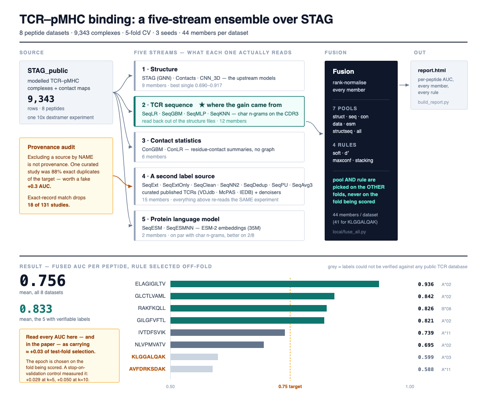

# A five-stream ensemble over STAG (TCR–pMHC binding)

A reproduction of [KavrakiLab/STAG_public](https://github.com/KavrakiLab/STAG_public) on all 8 peptide
datasets, plus four extra prediction streams fused on top of it.

**Headline: fused AUC 0.756 mean over 8 datasets, 0.824 over the 5 the paper's own HLA criterion treats as reliable.**
Four of eight clear 0.75. Every number below is 5-fold CV, mean of 3 seeds, with the fusion rule
chosen on the folds that are *not* being scored.



<sub>Vector version: [docs/workflow.svg](docs/workflow.svg)</sub>

**Frozen at tag `v1.0` (14 November 2026)** — the complete first round, negative results included.
`git checkout v1.0` returns exactly this state; later work continues from a new branch.

---

## Results

| peptide | HLA | fused AUC | best single model | gain |
|---|---|---:|---:|---:|
| ELAGIGILTV | A\*02 | **0.936** | 0.917 | +0.019 |
| GLCTLVAML | A\*02 | **0.842** | 0.818 | +0.024 |
| RAKFKQLL | B\*08 | **0.826** | 0.797 | +0.029 |
| GILGFVFTL | A\*02 | **0.821** | 0.801 | +0.020 |
| IVTDFSVIK | A\*11 | **0.739** | 0.690 | +0.049 |
| NLVPMVATV | A\*02 | **0.695** | 0.614 | +0.081 |
| KLGGALQAK | A\*03 | 0.599 | 0.567 | +0.032 |
| AVFDRKSDAK | A\*11 | 0.588 | 0.582 | +0.006 |
| **mean, all 8** | | **0.756** | 0.723 | +0.033 |
| **mean, 5 reliable (not A\*03/A\*11)** | | **0.824** | 0.789 | +0.034 |

`runs/report.html` is the whole result as one matrix — every model's AUC on every dataset, with
both fused columns at the right. `runs/report_full.html` is the long per-member, per-rule breakdown.
Both are written in Thai; every number in them is also in this README and in
`runs/results/fusion_all.json`.

**Fusing all five streams with stacking scores 0.756 too** (0.7564 against 0.7557 for the
per-dataset rule selection above). The selection machinery buys +0.0008 — nothing. If you want one
sentence for a methods section, "stack all 44 members, weights fitted on the other folds" is both
simpler and, within noise, the same number.

## Read this before quoting any number

**Every AUC here — and in the published paper — carries roughly +0.03 of test-fold selection.**
The training loop stops on the fold it is about to score. A stop-on-validation control run measured
the size of that effect directly: **+0.029 at k=5 and +0.050 at k=10**. It is not a bug introduced
here; it is inherited from the upstream training loop and applies to the baselines the same way,
so the *comparisons* are fair and the *absolute* values are optimistic. Numbers from
`k_control.sbatch` are in `runs/results/json_k5_val/` and `json_k10_val/`.

Two further limits worth stating plainly:

- **KLGGALQAK has zero published paired TCRs** in VDJdb, McPAS-TCR and IEDB once the 10x
  application note is excluded by *content* rather than by name. Its labels cannot be checked
  against anything independent, so its ~0.60 is a floor on our ignorance, not a model result.
- **The negatives the dextramer missed are where every dataset scores worst** (AUC 0.54–0.57
  against negatives of unknown provenance, which are 57–72 % of all negatives). The upstream
  ITRAP filtering was applied to the *positives* only.

## What is here that is not upstream

Five streams feed the fusion. The structure stream is upstream's; the other four are new.

| stream | members | reads |
|---|---|---|
| 1 structure | STAG, Contacts, CNN_3D | the modelled complex — upstream's own models |
| **2 TCR sequence** | SeqLR, SeqGBM, SeqMLP, SeqKNN | **char n-grams on the CDR3, read back out of the structure files** |
| 3 contact statistics | ConGBM, ConLR | residue-contact summaries, no graph |
| 4 second label source | SeqExt, SeqExtOnly, SeqClean, SeqNN2, SeqDedup, SeqPU, SeqAvg3 | curated published TCRs (VDJdb · McPAS · IEDB) + denoisers |
| 5 protein language model | SeqESM, SeqESMNN | ESM-2 (`esm2_t12_35M_UR50D`) embeddings |

The gain came from **stream 2**, not from ensemble size: 3 members → 9 members bought +0.004,
while adding the sequence stream moved the mean from 0.735 to 0.752. Streams 1, 3 and 5 all read
the same 10x experiment; stream 4 is the only one that brings a second source of labels.

### The provenance trap, in one paragraph

Excluding a data source **by name** is not provenance control. VDJdb files 181 NLVPMVATV pairs
under a medRxiv study (10.1101/2020.05.04.20085779); **159 of them (88 %) are exact α+β duplicates
of rows in the target dataset**, while sharing zero pairs with VDJdb's own 10x curation. Believing
that study would have inflated NLVPMVATV by roughly **+0.3 AUC**. `ext/provenance_audit.py` drops a
study when ≥20 % of its own α+β pairs appear exactly in the target and it has ≥5 pairs —
18 of 131 entries are dropped. Concordance with the target fell from 97.1 % to 7.0 % after the audit.

## Negative results (measured, so you do not have to repeat them)

Recording these is the point of the repo as much as the headline is.

| tried | outcome |
|---|---|
| ESM-2 embeddings | on par with char n-grams; better on 2 of 8 |
| PU learning | helps **only** on the two contaminated sets (+0.017, +0.019), nowhere else |
| confident-learning pruning | −0.01 |
| upstream's own duplicate filter, applied to training | −0.004 (398 conflicting rows across 8 datasets) |
| nearest-published-binder (SeqNN2) | below the incumbents |
| member screening inside the fusion | 0.741, worse than keeping everyone |
| **10-fold instead of 5-fold** | **+0.020 on test-stopping, −0.001 on validation-stopping — i.e. nothing real** |
| **two new structure encoders (EGNN, dual-tower)** | **lose to STAG on 8/8 alone; +0.009 in the k=10 fusion did NOT reproduce at k=5 (−0.001). Not adopted.** |

The last row is why `STAG_EGNN` / `STAG_DUAL` are present in `runs/results/preds_k5/` but switched
off by default. Re-run that test with:

```bash
STAG_INCLUDE_K5NEW=1 python3 local/fuse_all.py
```

## Reproducing

The 9.3 GB of upstream structure data is **not** in this repo. Clone upstream for that:

```bash
git clone https://github.com/KavrakiLab/STAG_public.git
cd STAG_public
# upstream needs small edits to run outside its original environment:
git apply /path/to/this/repo/stag-mac-compat-edits.patch
# the two new encoders live in models/STAG2/:
cp -r /path/to/this/repo/hpc/STAG2 models/
```

Then:

```bash
# 1. structure models, on a SLURM cluster (GPU, ~10 h for the full k=10 matrix)
sbatch hpc/k10_main.sbatch           # STAG / Contacts / CNN_3D / STAG_EGNN / STAG_DUAL
sbatch hpc/k_control.sbatch          # the stop-on-validation control

# 2. the other four streams, CPU, minutes each
python3 seqmodel/train_seq.py        # stream 2
python3 ext/vdjdb_pull.py            # stream 4 — pulls the public databases
python3 ext/provenance_audit.py      #          — then drops the contaminated studies
python3 seqmodel/embed_esm.py && python3 seqmodel/train_esm.py   # stream 5

# 3. fuse and report
python3 local/fuse_all.py            # writes runs/results/fusion_all.json
python3 local/build_matrix.py        # writes runs/report.html (model x dataset matrix)
python3 local/build_report.py        # writes runs/report_full.html (the long version)
```

`hpc/make_folds.py 5` regenerates the fold assignment; it reproduces the upstream folds row for row
(9,343 / 9,343 on all 8 datasets), which is what makes members from different runs fusable.

### Environment

- structure models: torch 2.1.0+cu121, PyG 2.3.1, scikit-learn 1.7.2, one GPU
- everything else: python 3.9+, numpy, scikit-learn; `fair-esm` for stream 5 only
- no GPU needed for streams 2–5

## Layout

```
local/      fusion + report generation      (fuse_all.py is the one that matters)
seqmodel/   streams 2 and 5, plus the label/negative probes
ext/        stream 4: database pullers, the merge, and the provenance audit
hpc/        SLURM scripts, the two new encoders (STAG2/model2.py), fold generation,
            and folds_k5/ — the exact fold assignment every member was scored on
seq/        derived CDR3 feature tables, one CSV per peptide
runs/       predictions (one CSV per method × seed × fold), fusion output,
            report.html (summary table) and report_full.html (everything)
```

## Attribution

Upstream model, datasets and the three baseline architectures are from the STAG paper:

> Slone, Conev, Rigo, Reuben, Kavraki. *STAG: Structure-based TCR–pMHC binding prediction.*
> IEEE/ACM Transactions on Computational Biology and Bioinformatics 22(1):171–179, 2025.
> doi:[10.1109/TCBBIO.2024.3504235](https://doi.org/10.1109/TCBBIO.2024.3504235) ·
> code: [KavrakiLab/STAG_public](https://github.com/KavrakiLab/STAG_public) (MIT)

The paper reports per-peptide results only as a figure (Fig. 4a), with no numeric table; values
quoted in comparisons here were read off that figure at 400 dpi and are accurate to about ±0.01–0.02.

Public TCR databases used by stream 4: VDJdb, McPAS-TCR, IEDB. Their raw downloads are not
redistributed here — `ext/vdjdb_pull.py` fetches them. Please cite them directly if you use them.

## License

MIT, same as upstream. See [LICENSE](LICENSE) and [NOTICE](NOTICE).
